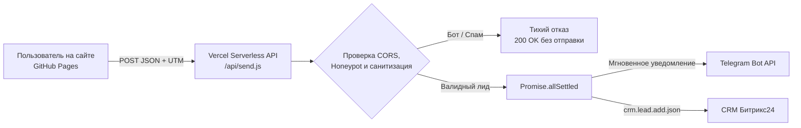

# Портфолио специалиста по внедрению CRM & Serverless-интеграция заявок

Адаптивный сайт-портфолио с переключением светлой/тёмной темы и полноценной продакшн-интеграцией формы обратной связи с **Telegram Bot API** и **CRM Битрикс24** через бессерверный прокси на **Vercel Serverless Functions**.

🌐 **Демо сайта:** [https://github.io](https://github.io)

---

## 🏗 Архитектура решения

Статический фронтенд не хранит секретных ключей. Все запросы проходят через бессерверный обработчик (Serverless Proxy), который валидирует данные, отсекает спам и параллельно отправляет уведомление в Telegram и создаёт лид в Битрикс24.



---

## ⚙️ Реализованный функционал

### 1. Интеграция и работа с данными
* **Параллельная доставка (`Promise.allSettled`):** запросы в Telegram и Битрикс24 выполняются одновременно, не блокируя друг друга при задержках одного из сервисов.
* **Умный парсинг контактов:** сервер автоматически определяет тип контакта (номер телефона или `@username` / ссылка `t.me/`) и записывает его в соответствующее системное поле карточки лида Битрикс24 (`PHONE` или `IM`).
* **Сквозная аналитика (UTM-метки):** автоматический захват `utm_source`, `utm_medium`, `utm_campaign`, `utm_content`, `utm_term` из адресной строки браузера и передача в системные поля аналитики лида в CRM.

### 2. Безопасность и защита от спама
* **Изоляция секретов:** токен Telegram-бота (`TELEGRAM_BOT_TOKEN`), ID чата (`TELEGRAM_CHAT_ID`) и URL входящего вебхука CRM (`BITRIX_WEBHOOK_URL`) хранятся исключительно в Environment Variables на Vercel.
* **Динамический CORS:** сервер проверяет заголовок `Origin` по белому списку доверенных доменов и выставляет `Vary: Origin`.
* **Двухуровневый антиспам без капчи:**
  * *Honeypot (поле-ловушка):* скрытое от человека поле, при заполнении которого сервер имитирует успешный ответ (`200 OK`), но прерывает отправку.
  * *Time-check:* отсечение автоматических скриптов, отправляющих форму быстрее чем за 2 секунды после загрузки страницы.
* **Санитизация входных данных:** очистка от управляющих символов и HTML-тегов (`<`, `>`), а также жёсткое ограничение длины полей на фронтенде и бэкенде.

### 3. Фронтенд
* Семантическая вёрстка на чистом **HTML5**, **CSS3 (CSS Variables)** и **Vanilla JavaScript (ES6+)** без сторонних библиотек и фреймворков.
* Переключение **светлой и тёмной темы** с определением системных предпочтений (`prefers-color-scheme`) и сохранением выбора в `localStorage`.

---

## 🛠 Стек технологий

* **Frontend:** HTML5, CSS3, JavaScript (Fetch API, URLSearchParams, localStorage)
* **Backend / Serverless:** Node.js, Vercel Serverless Functions
* **Интеграции и API:** Telegram Bot API, Битрикс24 REST API (Incoming Webhooks)
* **Хостинг и CI/CD:** GitHub Pages, Vercel

---

## 🚀 Локальный запуск и настройка

### Переменные окружения (Vercel Environment Variables)
Для работы бэкенда необходимо задать следующие переменные:

| Переменная | Описание | Пример значения |
| :--- | :--- | :--- |
| `TELEGRAM_BOT_TOKEN` | Токен бота, полученный от `@BotFather` | `123456789:AAH...` |
| `TELEGRAM_CHAT_ID` | ID чата или пользователя для уведомлений | `987654321` |
| `BITRIX_WEBHOOK_URL` | URL входящего вебхука Битрикс24 с правами `crm` | `https://bitrix24.ru` |

### Тестирование UTM-меток
Для проверки сквозной передачи источников перейдите на сайт с параметрами в URL:
```text
https://github.io?utm_source=github&utm_medium=readme&utm_campaign=portfolio_test
```

---

## 👤 Автор

**Марсель Дусметов** — специалист по внедрению CRM и автоматизации бизнес-процессов.
* Студент УГНТУ («Прикладная информатика в экономике и финансах ТЭК»).
* Сайт-портфолио: [softether239.github.io](https://github.io)
